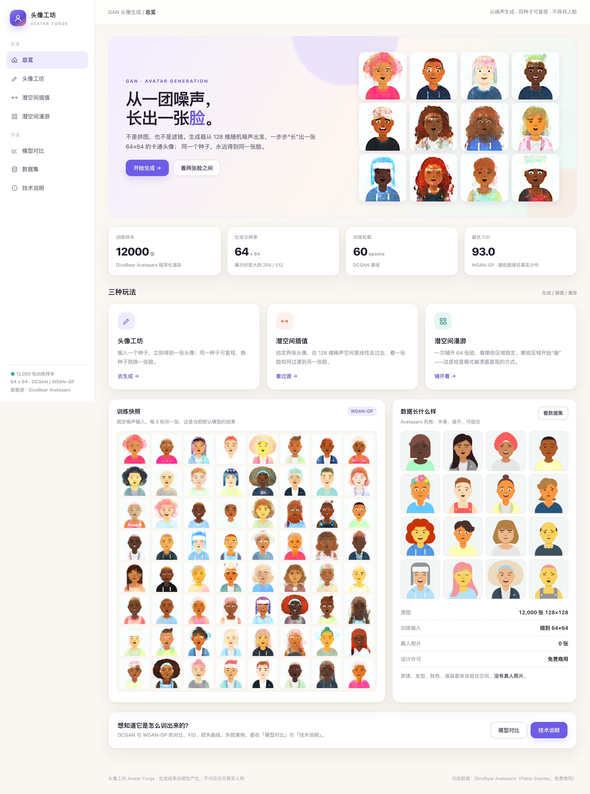
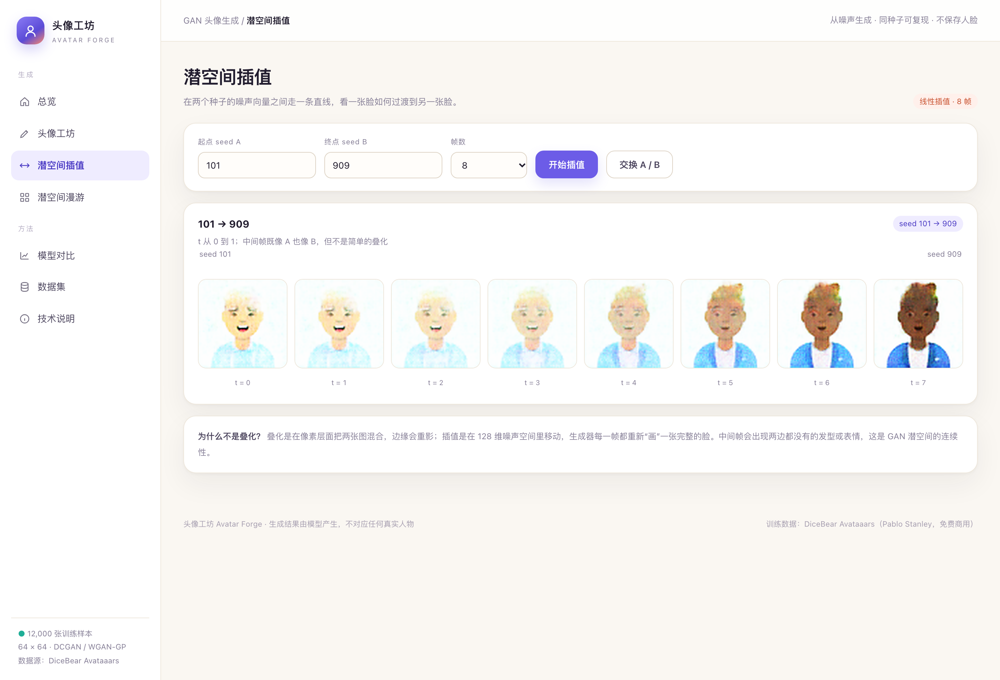
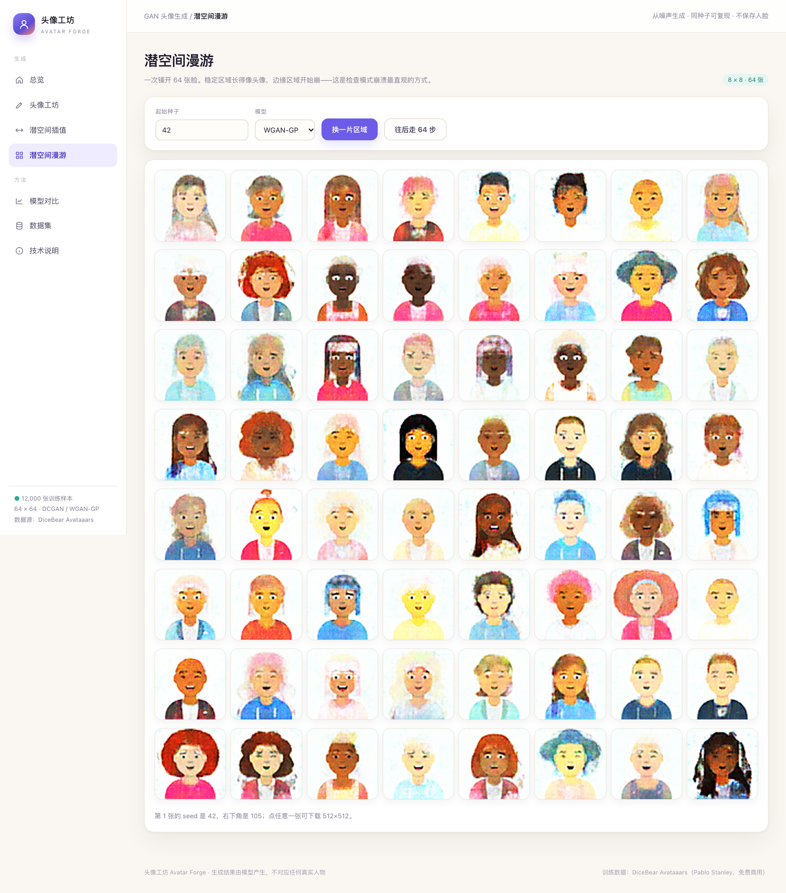
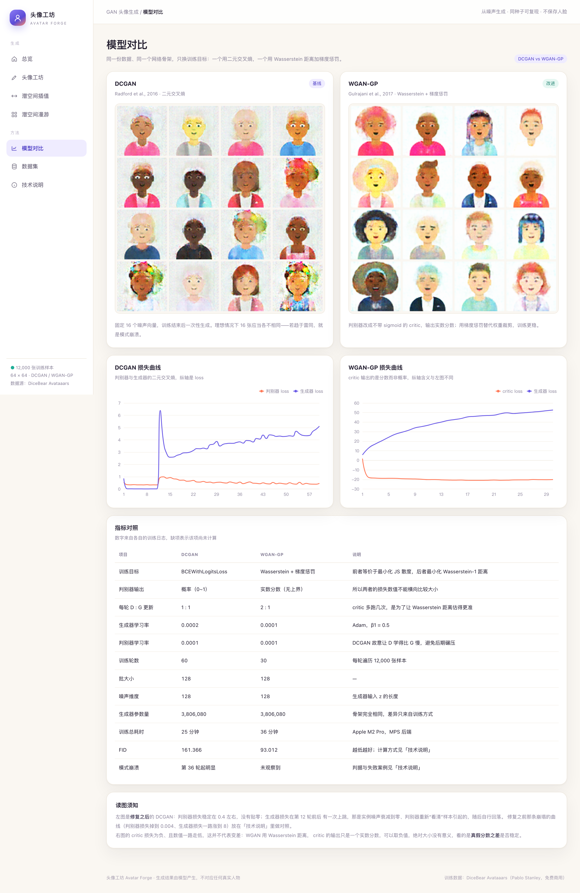
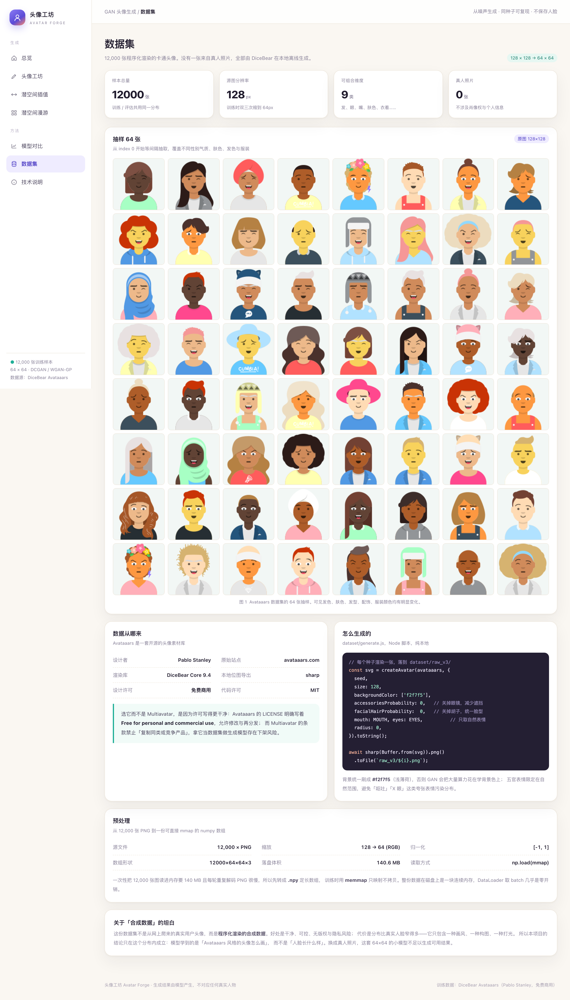
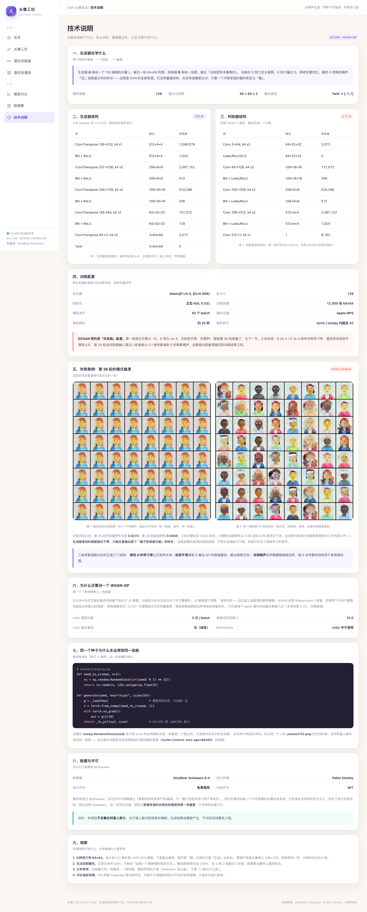

# 基于 GAN 的卡通头像生成系统

从一团噪声长出一张脸。用 DCGAN 与 WGAN-GP 训练一个 64×64 的卡通头像生成器，
再用 Django + ECharts 做成可生成、可插值、可漫游的站点。

**这是毕业设计的成果展示仓库**（截图 + 说明 + 交付清单），完整源码与文档见文末的获取方式。

## 这个项目做了什么

- **数据**：12,000 张 DiceBear Avataaars 合成头像，本地离线渲染，不采集任何真人照片
- **模型**：DCGAN（生成器 3.81 M / 判别器 2.77 M）与 WGAN-GP，同一份数据、同一套骨架
- **应用**：7 个页面 —— 总览 / 头像工坊 / 潜空间插值 / 潜空间漫游 / 模型对比 / 数据集 / 技术说明
- **重点**：完整记录并诊断了一次第 36 轮的模式崩溃，做了三项修复的对照实验

## 训练结果

| 模型 | 轮数 | 学习率 | 总耗时 | FID |
| --- | --- | --- | --- | --- |
| DCGAN | 60 | G 2e-4 / D 1e-4 | 25 分钟 | 161.37 |
| WGAN-GP | 30 | 1e-4（critic 2 次/批） | 36 分钟 | 93.01 |

FID 用 Inception-v3 的 pool3 特征，5000 张真实图对 5000 张生成图。
该指标对扁平卡通图不敏感，只用于两个模型之间的相对比较。

## 那次训练失败（本项目最值得看的部分）

第一次按 DCGAN 论文默认配置（G、D 同为 2e-4、无标签平滑、无噪声）训练时：

| 轮次 | D 损失 | G 损失 | 样张状态 |
| --- | --- | --- | --- |
| 20 | 0.3802 | 4.5971 | 噪点多，但肤色/发色/服饰有差异 |
| 35 | 0.0273 | 5.9801 | 临界点前一轮 |
| **36** | **0.0068** | **8.0551** | **塌缩为同一张脸** |
| 43 | 0.0037 | 7.3721 | 无恢复迹象 |

**成因**：判别器在 35→36 轮之间跨过临界点，把真假样本几乎完美分开。
此时 JS 散度趋于常数 log2，生成器收到的梯度趋近于零，参数几乎不再更新，
输出稳定在那个「当前最不容易被识破」的样本上。**不是生成器学不会，是它收不到该往哪学的信号。**

**修复**（三项，对应三个失效机制）：

| 措施 | 参数 | 对应问题 |
| --- | --- | --- |
| 非对称学习率 | G 2e-4 / D 1e-4 | 判别器任务更简单，同等学习率下会更快压制生成器 |
| 单边标签平滑 | 真实标签 0.9 | 避免 D 输出 0/1 的极端置信，为 G 留出梯度空间 |
| 实例噪声 | σ 0.1 线性衰减到 0（前 20 轮） | 模糊真假边界，逼 D 学整体结构而非高频纹理 |

修复后 60 轮未再崩溃，判别器损失稳定在 0.38~0.54。

## 另一个实现层面的坑

WGAN-GP 首次实现时 critic 直接复用了 DCGAN 的判别器（带 BatchNorm）。
训练开始后 critic 损失单调发散：第 1 轮 −67、第 2 轮 −202、第 3 轮 −321、第 4 轮 −490。

原因：梯度惩罚要求对**每个样本**求 critic 的输入梯度再取范数，
而 BatchNorm 在训练模式下用整个 batch 的统计量归一化，样本之间产生依赖，
逐样本的梯度范数不再有意义，Lipschitz 约束失效。

改用 InstanceNorm 后，同样配置下 critic 损失回到 −20 附近的有限区间。

## 界面

| 头像工坊 | 潜空间插值 |
| --- | --- |
|  |  |

| 潜空间漫游 | 模型对比 |
| --- | --- |
|  |  |

| 数据集 | 技术说明 |
| --- | --- |
|  |  |

## 技术栈

Python 3.8+ · PyTorch 2.2（Apple MPS / CUDA / CPU）· Django 4.2 · ECharts 5 · SQLite
数据集构建：Node.js 18 + DiceBear Core 9.4 + sharp

## 数据来源与许可

- 素材：[Avataaars](https://avataaars.com/)，设计者 Pablo Stanley，**免费商用**
- 渲染库：[DiceBear](https://www.dicebear.com/styles/avataaars/)，代码 MIT
- 生成结果由模型产生，不对应任何真实人物

> 最初考虑过 Multiavatar，但其许可禁止「重打包现有设计资产」与「用于同类或竞争产品」，
> 与「做一个对外提供的头像生成系统」的目的冲突，因此改用 Avataaars。

## 局限

1. **分辨率只有 64×64**。展示时放大到 256/512 是 LANCZOS 插值 + 轻度锐化，不是超分重建，
   放大不会凭空长出细节。
2. **无法控制属性**。这是无条件 GAN，不能说「给我一个戴眼镜的短发女生」，
   要控制就得改成条件 GAN。
3. **分布很窄**。训练集只有一种画风、一种构图，模型学到的是「Avataaars 怎么画」，
   不是「人脸长什么样」。
4. **评价指标单一**。没有计算多样性的量化指标，对是否还有残余塌缩只能靠肉眼判断。

## 获取完整源码

完整交付包含：源码、12,000 张数据集、两组预训练权重、四件套文档（任务书 / 开题报告 / 论文 / 使用说明）、
8 张界面截图、7 张论文配图、90 秒演示视频。

- 成品页：https://bishe.suilang.net/products/avatar-forge
- 获取地址：https://mbd.pub/o/bread/YZaWlp5qaw==
- 演示视频：https://www.bilibili.com/video/BV18xWd6KEeX/

论文 226 段 / 10 表 / 7 图，七章制；源码含 26 项单元测试。
